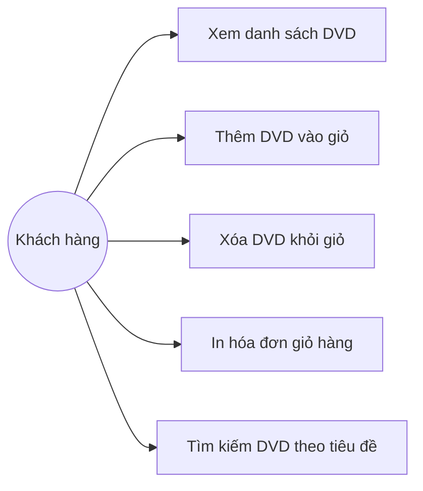

# Use Case Diagram & Đặc tả AIMS-mini

## 1. Sơ đồ Use Case tổng quan

## 2. Mô tả các ca sử dụng
- **UC1 - Xem danh sách DVD**: Hiển thị thông tin DVD (tiêu đề, thể loại, đạo diễn, thời lượng, giá).
- **UC2 - Thêm DVD vào giỏ**: Cho phép thêm tối đa 20 đĩa DVD.
- **UC3 - Xóa DVD khỏi giỏ**: Gỡ bỏ một DVD đã chọn khỏi giỏ hàng.
- **UC4 - In hóa đơn giỏ hàng**: In danh sách các món đồ kèm tổng chi phí.
- **UC5 - Tìm kiếm DVD**: Tìm kiếm các DVD theo từ khóa tiêu đề.